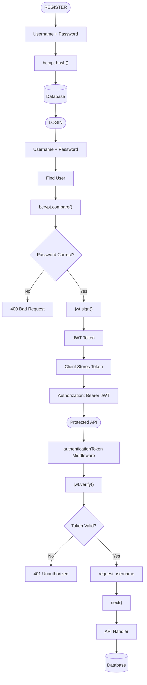
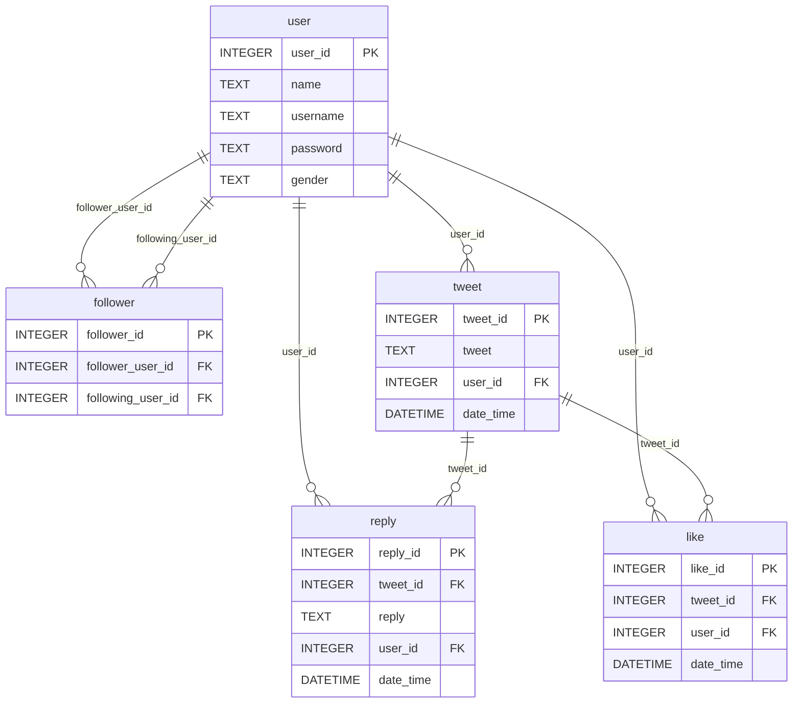

# 🐦 Twitter Clone REST API

A backend REST API that replicates core Twitter functionality — user registration, authentication, tweeting, following, liking, and replying — built with **Node.js**, **Express.js**, **SQLite**, **bcrypt**, and **JWT**.

---

## 📖 Overview

This project is a Twitter-like social media REST API where users can:

- Register and log in securely with hashed passwords and JWT-based authentication
- View a personalized tweet feed from users they follow
- Create and delete their own tweets
- View likes and replies on tweets from users they follow
- See who they follow and who follows them

All endpoints (except register and login) are protected by JWT Bearer token authentication.

---

## ✨ Features

- **User Registration** with duplicate username detection and password length validation
- **User Login** with bcrypt password verification and JWT token generation
- **JWT Authentication Middleware** protecting all user-specific endpoints
- **Tweet Feed** showing the latest 4 tweets from followed users (sorted by newest first)
- **Following / Followers** lists
- **Tweet Details** with like count and reply count (only for tweets by followed users)
- **Likes List** — usernames of users who liked a tweet (only for tweets by followed users)
- **Replies List** — names and replies on a tweet (only for tweets by followed users)
- **Create Tweet** for the authenticated user
- **Delete Tweet** with ownership verification (only the tweet owner can delete)

---

## 🛠️ Tech Stack

| Technology  | Purpose                          |
| ----------- | -------------------------------- |
| Node.js     | JavaScript runtime               |
| Express.js  | Web framework for REST APIs      |
| SQLite      | Lightweight relational database  |
| sqlite3     | SQLite driver for Node.js        |
| sqlite      | Async SQLite wrapper             |
| bcrypt      | Password hashing                 |
| jsonwebtoken| JWT generation and verification  |
| dotenv      | Environment variable management  |
| nodemon     | Auto-restart during development  |

---

## 🔐 Authentication

The project uses a **JWT Bearer Token** authentication flow:

```
Register → bcrypt password hashing → Stored in SQLite

Login → bcrypt password comparison → JWT generation → Bearer token returned

Protected API Request → Authorization: Bearer <JWT> → jwt.verify() → request.username → API handler
```

### How It Works

1. **Register** (`POST /register/`): User provides `username`, `password`, `name`, `gender`. The password is hashed with bcrypt (salt rounds: 10) and stored in SQLite.

2. **Login** (`POST /login/`): User provides `username` and `password`. The server verifies the password with `bcrypt.compare()`. On success, a JWT is signed with the payload `{ username }` and returned as `{ jwtToken }`.

3. **Protected Endpoints**: The client sends the JWT in the `Authorization` header:
   ```http
   Authorization: Bearer <JWT_TOKEN>
   ```
   The `authenticationToken` middleware extracts the token, verifies it with `jwt.verify()`, and attaches `request.username` for downstream handlers.

4. **Invalid/Missing Token**: Returns `401` with the message `Invalid JWT Token`.

### Authentication Flow Diagram



---

## 🗄️ Database

The application uses an SQLite database (`twitterClone.db`) with the following five tables:

### Tables

**user**

| Column   | Type    | Description                  |
| -------- | ------- | ---------------------------- |
| user_id  | INTEGER | Primary key                  |
| name     | TEXT    | Display name                 |
| username | TEXT    | Unique login username        |
| password | TEXT    | bcrypt-hashed password       |
| gender   | TEXT    | User gender                  |

**follower**

| Column              | Type    | Description                                              |
| ------------------- | ------- | -------------------------------------------------------- |
| follower_id         | INTEGER | Primary key                                              |
| follower_user_id    | INTEGER | User ID of the person who follows (references user.user_id) |
| following_user_id   | INTEGER | User ID of the person being followed (references user.user_id) |

> If **user1** follows **user2**, then `follower_user_id = user1.user_id` and `following_user_id = user2.user_id`.

**tweet**

| Column    | Type     | Description                           |
| --------- | -------- | ------------------------------------- |
| tweet_id  | INTEGER  | Primary key                           |
| tweet     | TEXT     | Tweet content                         |
| user_id   | INTEGER  | Author of the tweet (references user.user_id) |
| date_time | DATETIME | Timestamp of creation                 |

**reply**

| Column    | Type     | Description                            |
| --------- | -------- | -------------------------------------- |
| reply_id  | INTEGER  | Primary key                            |
| tweet_id  | INTEGER  | Tweet being replied to (references tweet.tweet_id) |
| reply     | TEXT     | Reply content                          |
| user_id   | INTEGER  | Author of the reply (references user.user_id) |
| date_time | DATETIME | Timestamp of reply                     |

**like**

| Column    | Type     | Description                            |
| --------- | -------- | -------------------------------------- |
| like_id   | INTEGER  | Primary key                            |
| tweet_id  | INTEGER  | Tweet being liked (references tweet.tweet_id) |
| user_id   | INTEGER  | User who liked it (references user.user_id) |
| date_time | DATETIME | Timestamp of like                      |

### ER Diagram



---

## 📋 API Overview

| #  | Method   | Endpoint                    | Auth     | Description                                          |
| -- | -------- | --------------------------- | -------- | ---------------------------------------------------- |
| 1  | `POST`   | `/register/`                | ❌ No    | Register a new user                                  |
| 2  | `POST`   | `/login/`                   | ❌ No    | Login and receive JWT token                          |
| 3  | `GET`    | `/user/tweets/feed/`        | ✅ Yes   | Get latest 4 tweets from followed users              |
| 4  | `GET`    | `/user/following/`          | ✅ Yes   | Get list of users the logged-in user follows         |
| 5  | `GET`    | `/user/followers/`          | ✅ Yes   | Get list of users who follow the logged-in user      |
| 6  | `GET`    | `/tweets/:tweetId/`         | ✅ Yes   | Get a tweet with like/reply counts (followed users only) |
| 7  | `GET`    | `/tweets/:tweetId/likes/`   | ✅ Yes   | Get usernames who liked a tweet (followed users only)|
| 8  | `GET`    | `/tweets/:tweetId/replies/` | ✅ Yes   | Get replies on a tweet (followed users only)         |
| 9  | `GET`    | `/user/tweets/`             | ✅ Yes   | Get all tweets of the logged-in user                 |
| 10 | `POST`   | `/user/tweets/`             | ✅ Yes   | Create a new tweet                                   |
| 11 | `DELETE` | `/tweets/:tweetId/`         | ✅ Yes   | Delete a tweet (owner only)                          |

> For detailed request/response documentation, see [API_DOCUMENTATION.md](API_DOCUMENTATION.md).

---

## 📁 Project Structure

```
social-connect-REST_API/
├── app.js                  # Main application file (Express server, middleware, all API routes)
├── twitterClone.db         # SQLite database file
├── package.json            # Project metadata and dependencies
├── package-lock.json       # Dependency lock file
├── .env                    # Environment variables (JWT_SECRET) — not committed to git
├── .env.example            # Example environment file for local setup
├── .gitignore              # Git ignore rules
├── app.http                # REST Client test file for VS Code
├── diagrams/
│   └── twitter-authentication.mmd   # Mermaid authentication flow diagram
├── README.md               # This file
├── API_DOCUMENTATION.md    # Detailed API documentation
└── openapi.yaml            # OpenAPI 3.0 specification (Swagger)
```

---

## 🚀 Installation

### Prerequisites

- [Node.js](https://nodejs.org/) (v14 or higher recommended)
- npm (comes with Node.js)

### Steps

1. **Clone the repository**

   ```bash
   git clone <repository-url>
   cd social-connect-REST_API
   ```

2. **Install dependencies**

   ```bash
   npm install
   ```

3. **Set up environment variables**

   Create a `.env` file in the project root:

   ```env
   JWT_SECRET=your_jwt_secret_key_here
   ```

4. **Run the server**

   For production:
   ```bash
   npm start
   ```

   For development (with auto-restart):
   ```bash
   npm run dev
   ```

5. **Access the API**

   The server starts at:
   ```
   http://localhost:3000/
   ```

---

## 🔑 Environment Variables

| Variable     | Description                              | Required |
| ------------ | ---------------------------------------- | -------- |
| `JWT_SECRET` | Secret key used to sign and verify JWTs  | ✅ Yes   |

### `.env.example`

```env
JWT_SECRET=your_jwt_secret_key_here
```

> ⚠️ **Never commit your actual `.env` file or expose your JWT secret.** The `.gitignore` already excludes `.env` files.

---

## 📚 API Documentation

For complete API documentation with request/response examples, error codes, and authentication details, see:

- 📄 **[API_DOCUMENTATION.md](API_DOCUMENTATION.md)** — Detailed endpoint documentation
- 🔗 **[openapi.yaml](openapi.yaml)** — OpenAPI 3.0 specification (compatible with Swagger UI)

---

## 🔮 Future Improvements

> **Note:** These features are **not currently implemented**. They are suggestions for future development.

- **Input validation** — Validate request body fields (e.g., check for empty username/tweet, valid gender values)
- **Pagination** — Add query parameter-based pagination for feed, followers, and tweet lists
- **User profile endpoint** — `GET /user/profile/` to retrieve the logged-in user's own profile
- **Follow/Unfollow endpoints** — `POST /user/follow/:userId/` and `DELETE /user/unfollow/:userId/`
- **Like/Unlike endpoints** — `POST /tweets/:tweetId/like/` and `DELETE /tweets/:tweetId/like/`
- **Reply endpoint** — `POST /tweets/:tweetId/reply/`
- **Error handling middleware** — Centralized error handling for database and server errors
- **Rate limiting** — Prevent API abuse with request rate limits
- **Testing** — Add unit and integration tests using tools like Jest or Mocha
- **API versioning** — Prefix routes with `/api/v1/` for future compatibility
- **CORS configuration** — Enable cross-origin requests for frontend integration

---

## 📝 License

ISC

---

<p align="center">
  Built with ❤️ using Node.js, Express.js, SQLite, and JWT
</p>
